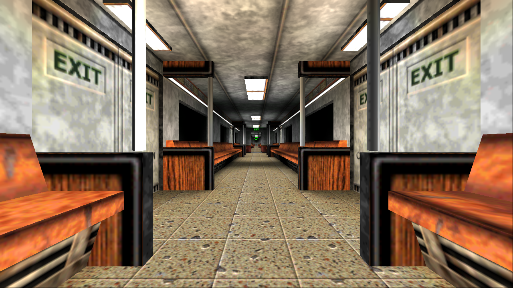
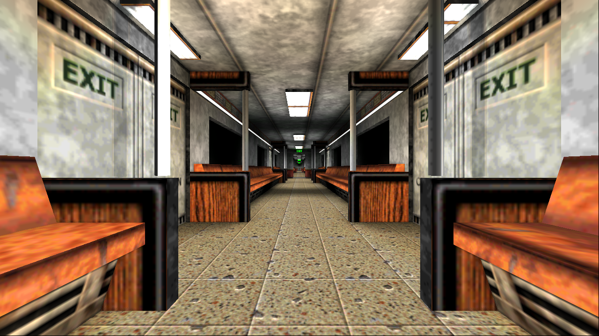
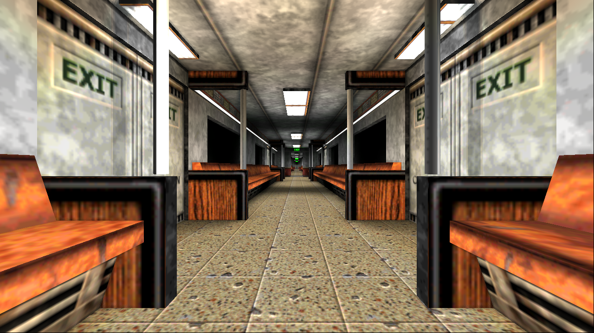

# Bloom and point-light shadow validation

Tests performed 2026-10-10/11 on an isolated Blood II installation at 1280×720, windowed/background,
using the renderer command-file, bookmarks, captures and GPU timestamp infrastructure. Assets were unchanged.
The controlled light is at camera + forward × 40, radius 400. Camera `geometry_test` is
`-32 180 -3180 0 0 0 1` in `01_SubwayA`; game lights were disabled for the single-light oracle.
Both effects ship disabled. See [configuration and implementation](../modernisation.md).

## Reviewed captures

| Dynamic shadows off | Dynamic shadows on |
|---|---|
|  |  |

| Bloom off | Bloom on, intensity 0.15, threshold 1 |
|---|---|
|  |  |

The same scene geometry is reused across each capture's variants. Structural panels/pillars block the
additional light, and opaque posed models participate in casting. The existing flattened model shadow can
also be present with `d_Shadows 0`; the new point-light visibility does not remove it. Bloom increases
emissive/dynamic highlights while preserving the original base colour. `shadow_visibility.png` shows
coverage in blue and occlusion in green; this is a diagnostic, not the final shaded image.

## Checks

- x86 LDC debug and release builds and all nine GLSL/SPIR-V shaders compiled successfully.
- Standalone tests check the six face projections and boundaries, translated origins, near/far planes,
  sphere/AABB and face culling, selection/frustum rejection, incumbent hysteresis, nearby-flash priority,
  zero budget and non-overlapping allocation for 1..4 point lights.
- CPU rays through dumped opaque static triangles independently check the quantised PCF sample rays.
  In this view all **290 / 290** samples blocked along every ray had zero additional light, median residual 0.
  An earlier camera gave **187 / 187**. Filtered silhouette transitions, dynamic casters, masked surfaces and
  undumped Gouraud geometry are excluded from this oracle; an unblocked CPU ray is not proof against a model shadow.
  See `geometry_raycheck.json` and `tools/validate_shadows.py`.
- `d_Lighting 0` with point shadows off/on produced byte-identical captures. Bloom on with intensity zero and
  FXAA off matched bloom off byte-for-byte, including the original UNORM blending/clamping.
- A temporary dual-pipeline validation build rendered original HEAD world/object fragment shaders and
  the final scene shaders against the identical collected frame. PNGs matched byte-for-byte for classic
  lighting with no lights, classic lighting with game lights plus the synthetic light, and modern lighting
  with game lights plus the synthetic light. Test pipelines/settings are absent from shipping source.
  The `compatibility_*.json` files record the variants; `originalshader` is a temporary test key, not a console option.
  Exact PNG SHA-256 matches and the original Git commit are recorded in `compatibility_hashes.json`.
- Point budgets 0/1/2/4, simultaneous static-lamp maps and point maps, bloom with FXAA and `d_Compare` were exercised.
  Reviewed ceiling self-shadow bands were fixed using radial depth and texel-centred receiver-plane comparisons.
- The Vulkan validation layer was unavailable. Renderer heartbeat logs reported no caught exceptions during the tests.

## GPU timings

The JSON files preserve timestamp samples and the settings/selected faces. `bloom` times the pyramid;
`post` includes the pyramid plus final composition. Source-attachment/material shading is charged to world/objects.
Map allocation/clear is charged to `static_shadows` even when only point lights use the atlas. These are captures
of one view, not averages across gameplay. GPU clock/power state varied: earlier RTX captures were much slower
than the warmed final captures. Actors and light effects also differ between separate adapter runs.

Final shipping-pass measurements are recorded in `rtx_timings.json` and `igpu_timings.json`.

| GPU stage / delta, milliseconds | RTX 4090 | AMD Radeon Graphics iGPU |
|---|---:|---:|
| One point light: shadow-map rendering | 0.099 | 0.493 |
| One point light: added world/sky receiver shading | 0.668 | 4.622 |
| Bloom pyramid only | 0.242 | 0.573 |
| Bloom pyramid plus final composition, FXAA off | 0.287 | 0.751 |
| Extra world/sky shading for the float bloom source | 0.113 | 0.673 |
| Bloom plus FXAA: complete post stage | 0.345 | 1.341 |

These rows isolate one broad 400-unit synthetic light (budget 2, one active), with static lamp shadows off.
The receiver/source deltas compare the `off`, `on` and `bloom` variants from the same collected frame.
They exclude object-shading deltas and GPU clock variability; they are not whole-feature frame-time guarantees.
Receiver shading is the largest added cost on the AMD iGPU; the small shadow maps themselves are inexpensive.
Start with `d_DynamicShadowLights 1` there, especially above 720p. The iGPU presents through the NVIDIA display,
so display/copy costs are not representative of an iGPU driving its own screen.

The images here are renamed representative PNGs, and the JSON files retain their original capture filenames.
Full colour/depth/atlas bundles and logs remain in the ignored `.build/runtime/captures` test directory; rerun
the documented capture commands to make a self-contained bundle on another installation.

## City Hub masked-fence selection fix (2026-10-12)

The entrance fence in `02_CITYHUB` was missing from the selected lamp/caster pairs even with a
64-pair budget. Its world-space bounds are `[576, -127, 2688]` to `[800, 0, 2704]`: a 16-unit
thickness along Z, but a 129-unit enclosing-sphere radius. Ranking lamps at the far side of that
sphere rejected useful lamps or greatly reduced their priority. World models now retain their
emitted AABB half-extents and rank lamps at the far bound along the lamp-to-centre ray.
The sphere still fits the shadow projection; the alpha-mask shader is unchanged.

The geometry regression tests cover the captured fence/lamp coordinates, opposite rays,
zero-thickness bounds and a lamp at the box centre. Debug and release builds passed.
The user returned to the same fence after installing the release and confirmed that its bar
pattern was visible on the floor. Gameplay was controlled by the user for this confirmation.

## Remaining coverage

This is a targeted implementation/validation pass, not a complete Blood II map or hardware sweep. More playtesting
is needed for fast muzzle/explosion lifetimes, camera-selection transitions, different doorway/corner layouts,
thin masked grates, moving world-model doors and smooth-normal bias at silhouettes. Fixed 256px faces can miss
thin occluders, PCF intentionally softens edges and casters inside the near plane can be clipped. Unselected
lights retain unshadowed lighting. No new 4K performance claim is made for these effects.
